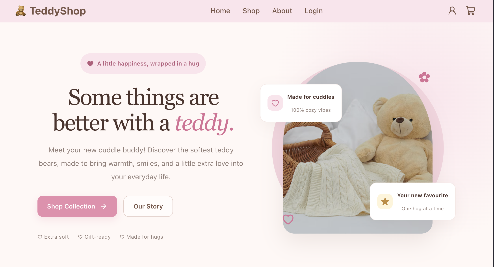
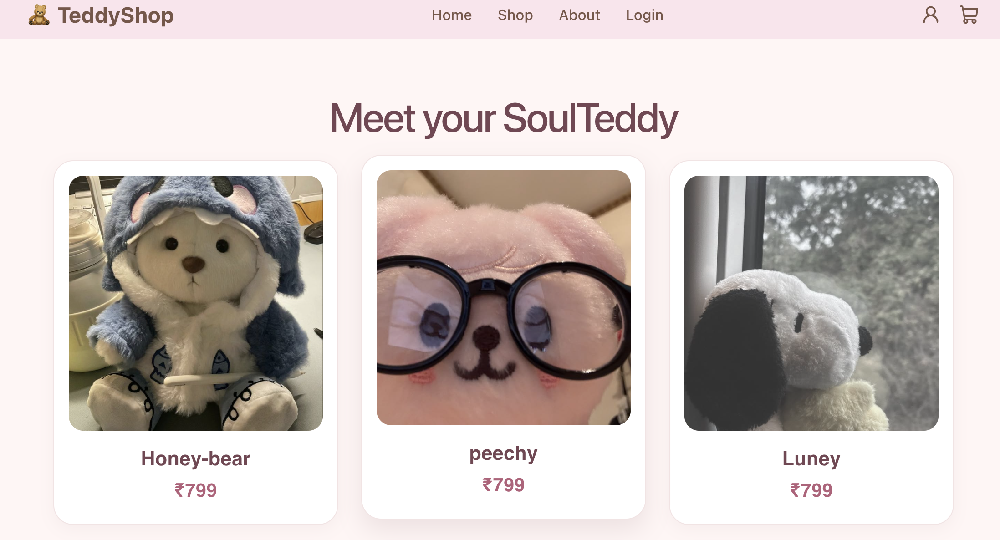
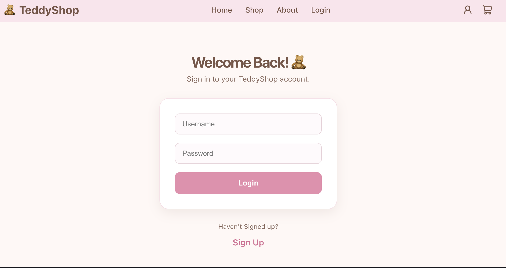
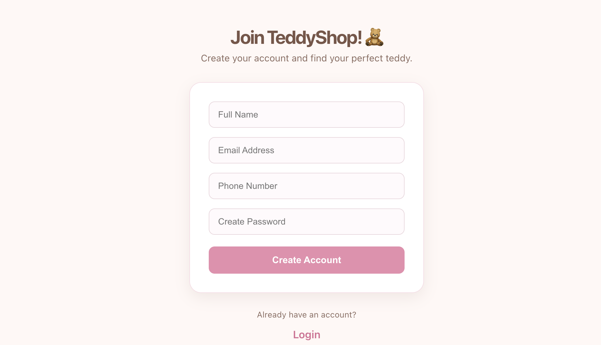

# 🧸 TeddyShop

### A little shop full of cuddles and cuteness 💗

TeddyShop is a teddy bear e-commerce practice project built with React and TypeScript. The project focuses on creating a cute shopping experience while learning API integration, data flow, reusable components, and modern frontend development.

## 📸 Screenshots

### 🏠 Home Page



### 🛍️ Shop Page



### 🔐 Login Page



### ✨ Signup Page



## ✨ Features

- 🧸 Browse teddy bear products
- 💕 Display product images and prices
- 🏷️ Support original prices and discount calculations
- 📦 Store product categories and stock information
- 🔄 Fetch product data through a JSON Server API
- 🧩 Build reusable React components
- 🎨 Cute, cozy shopping interface

*Features are being developed incrementally.*

## 🛠️ Tech Stack

| Technology | Purpose |
|---|---|
| React | User interface |
| TypeScript | Type safety |
| Vite | Development environment and build tooling |
| React Router | Client-side navigation |
| JSON Server | Mock REST API |
| CSS | Styling |

## 📂 Project Structure

```text
teddybearshoppractise/
├── public/
│   └── screenshots/
│       ├── Home.png
│       ├── Shop.png
│       ├── About.png
│       ├── Login.png
│       └── Signup.png
├── src/
│   ├── api/
│   │   └── products.ts
│   ├── components/
│   │   └── ProductCard.tsx
│   ├── Product.ts
│   └── pages/
│       └── Shop.tsx
├── db.json
├── package.json
└── README.md
```

*The structure above illustrates the intended organization and may change as development continues.*

## 🔄 Application Data Flow

TeddyShop uses JSON Server to expose product information through an API.

```text
db.json
   ↓
JSON Server
   ↓
fetchProducts()
   ↓
useEffect()
   ↓
useState()
   ↓
Shop Component
   ↓
ProductCard Components
```

### How it works

1. Product information is stored in `db.json`.
2. JSON Server exposes the product data through a REST API.
3. The API utility fetches the products using `fetch()`.
4. React's `useEffect` triggers the fetching logic.
5. `useState` stores the retrieved products.
6. The Shop component passes individual products to reusable product cards.

## 🚀 Getting Started

### Prerequisites

- Node.js
- npm

### 1. Clone the repository

```bash
git clone YOUR_GITHUB_REPOSITORY_URL
cd teddybearshoppractise
```

Replace `YOUR_GITHUB_REPOSITORY_URL` with your actual repository URL.

### 2. Install dependencies

```bash
npm install
```

### 3. Start the mock API

```bash
npm run server
```

The products endpoint should be available at:

`http://localhost:3000/products`

### 4. Start the frontend

Open a second terminal in the project directory and run:

```bash
npm run dev
```

Open the local URL displayed in your terminal to view the application.

## 🗃️ Product Data Model

Each product contains the following fields:

| Field | Description |
|---|---|
| `id` | Unique product identifier |
| `name` | Product name |
| `price` | Current selling price |
| `originalPrice` | Original price before discount |
| `category` | Product category |
| `stock` | Available quantity |
| `featured` | Whether the product is featured |
| `image` | Product image URL |

## 🎯 Learning Goals

Through TeddyShop, I'm practising:

- React hooks: `useState` and `useEffect`
- Fetching data from REST APIs
- TypeScript types and props
- Reusable component development
- Separation of concerns
- Rendering dynamic data
- Organizing a React project
- Managing product information using JSON Server

## 🔮 Future Improvements

- 🔍 Product search and category filtering
- ↕️ Sorting products by price
- 🛒 Shopping cart functionality
- 📄 Individual product detail pages
- 🔐 User authentication
- ⚙️ FastAPI backend integration
- 📱 Responsive design improvements

---

### Made with 💗 and lots of teddy bear energy 🧸
